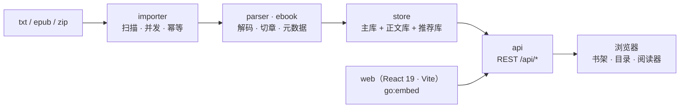

# norvels

**把一大堆中文 txt / EPUB 小说变成一个可浏览、可检索、能沉浸阅读的私人书库。** 单二进制 + SQLite 三库（元数据主库 / 正文库 / 可重建的推荐库）+ 轻量容器镜像；无外部依赖，不联网也能读。

> 4.4 GB / 865 个文件的中文 txt 一次导入，得到「书架 → 目录 → 阅读 → 找书」的完整链路；手机上有自研分页引擎与五种翻页效果。

## 功能特性

**导入与书库**

- **多格式导入**：`.txt` / `.epub` / `.zip`（上传或目录扫描）；EPUB 带出书名/作者/简介/分类/系列/封面与卷层级；不支持的格式当场说明原因。
- **编码自适应**：UTF-8 / BOM / GB18030 / UTF-16 / Big5 / Shift-JIS 多候选 + CJK 打分，乱码文件也能入库。
- **智能切章**：`第X章/节/回/卷/部`、`Chapter N`、数字行、`序章/楔子/番外`；支持卷嵌套、无标记短篇兜底、合集按章号重置自动拆书。
- **幂等导入与判重**：SHA-256 去重，`--force` / `--update`（追更只追加）/ `--dry-run` / `--workers`；章级正文指纹 + 版本择优 + 质量分，系列聚合、标签、书单、评分齐全。
- **AI 选书与元数据补全（可选）**：`--ai` 判该不该入库；`norvels enrich` 按 Legado 书源补作者/简介/分类，多源投票 + 默认 dry-run + 可整批回滚。
- **书名检索**：`LIKE` 子串，毫秒级；正文不建全文索引（[ADR-0002](docs/adr/0002-drop-fulltext-index.md)），找正文用阅读器里的章内搜索。

**阅读体验**（现状与边界见 [docs/reading.md](docs/reading.md)）

- **手机分页 + 五种翻页效果**：滑动 / 覆盖 / 淡入淡出 / 仿真折页 / 无动画，跟手拖动、松手提交或回弹；PC 恒为连续滚动。
- **排版与主题**：字号五档、行距、段距、页宽、对齐、缩进、四种字体族（含阅读障碍友好）、繁转简；七档主题含纯黑与高对比。
- **书签与搜索**：段落级书签（幂等、可导出 Markdown / JSON）、章内搜索（高亮 + 上/下一处）。
- **朗读与 AI 辅读**：系统语音零依赖、0.5–2.0 倍速、章末自动翻章；整章概括 / 解释选中段 / 本章问答，任意 OpenAI 兼容接口。
- **离线与多端**：可装成 PWA，断网仍能读最近 24 章；排版设置按账号同步，进度记到「章 + 段」。
- **无障碍**：焦点陷阱、控制层 inert、按页读屏取文、快捷键帮助（`?`）。

## 架构



## 目录结构

```text
norvels/
├── cmd/            norvels（import / serve / enrich / stats / migrate / version）· healthcheck · codebench
├── internal/       数据 store·model ｜ 解析 parser·ebook·importer·textcode ｜ 书源 booksource·source·rule*·fetch
│                   ｜ 治理 ai·enrich·recommend·recstore ｜ 平台 api·config·observe·releases·webui
├── web/            React 19 + Vite + Tailwind；features/reader 是最大的前端域
├── deploy/         Dockerfile · compose.yml · compose.dev.yml · nas/
├── scripts/        导入 / 备份 / 预览 / 截图 / 门禁 / 阅读器审计 / 语料工具
├── docs/           架构 · API 契约 · 部署 · 阅读体验 · 对标路线 · ADR · 规格记录
└── Makefile · go.mod · README.md
```

## 快速开始

### 本地（3 条命令）

```bash
make preview                                                     # 后端 :8080 + vite HMR :5173（已在跑则复用）
./bin/norvels import --dir "/path/to/txt" --db ./data/norvels.db  # 目录或单个 txt/epub/zip；加 --ai 先让模型判
make build                                                       # 生产产物 bin/norvels（前端先同步进 go:embed）
```

改前端看 <http://127.0.0.1:5173>（HMR，`/api` 代理到 :8080），生产行为走 <http://127.0.0.1:8080>；后台跑用 `--detach`、收尾 `--stop`（只收它自己起的）。
等长任务别自己 sleep 轮询：`scripts/wait-for.sh --host nas --until '<判定>' --timeout 3600` 一次阻塞到条件成立。

### Docker（3 条命令）

```bash
docker build -f deploy/Dockerfile -t norvels:0.13.5 .   # 1) 构建镜像（tag 与 Makefile 的 VERSION 同名）
NORVELS_BOOKS_DIR="/path/to/txt" docker compose -f deploy/compose.yml \
  run --rm --entrypoint /norvels norvels import --dir /books --db /data/norvels.db   # 2) 先导入
NORVELS_BOOKS_DIR="/path/to/txt" docker compose -f deploy/compose.yml up -d          # 3) 启动
```

宿主 `8080` → 容器 `8080`；`./data` → `/data`；源目录挂到 `/books`（只读）。也可直接拉镜像（见 [部署指南](docs/deploy.md)）。
资源：日常浏览 1 vCPU / 1 GB 足够（RSS 约 50–100 MB）；导入 4.4 GB 用 2 vCPU / 2 GB 并留 ≥ 5 GB 空闲。磁盘用本地 SSD，导入期间不要并发备份。

## 常用命令

| 命令 | 作用 |
|---|---|
| `make build` / `make build-server` / `make run` | 完整构建 / 只编后端 / 只起后端 :8080 |
| `make preview` | 预览：后端 :8080 + vite HMR :5173（已在跑则复用） |
| `make gate` | 提交前完整门禁 9 项（默认串行，`--parallel` 才并行） |
| `make gate-fast` | 快环：gofmt + vet + 前端 `tsc --noEmit`（秒级，通过 ≠ 门禁通过） |
| `make audit-reader` | 阅读器体验审计（真浏览器 390×844，18 条不变量） |
| `make shot URL=… OUT=…` | 截图取证（`VIEWPORT=390x844,1280x800` 可多视口一次拍完） |
| `scripts/import.sh --dir <目录>` | 批量导入（本地 / docker 两种模式） |
| `scripts/enrich.sh -- --plan` | 元数据补全待补清单；`--apply` 才写库（可整批回滚） |
| `scripts/backup.sh --keep 7` | 主库 + 正文库成对备份（推荐库可重建，不进备份） |
| `make bench-capacity` | 容量压测（500 本 × 500 章合成库，不碰生产库） |
| `./bin/norvels version` | 版本、commit、构建时间 |

## API 与升级

契约正文见 [docs/api.md](docs/api.md)（书籍/章节/书签、阅读进度与时长、书架与账号、导入任务、书源与替换规则、驾驶舱、推荐）；Base 为 `/api`，响应均为 JSON。
迁移只前进，回滚 = 连数据库一起从备份恢复；大库迁移 20+ 分钟且期间不监听端口。磁盘预留按迁移当次算：`0017` ≥35 GB、`0018` ≥50 GB，迁移后两个库各要 `VACUUM` 才真正回落（见 [docs/deploy.md](docs/deploy.md)）。

## 常见问题

乱码、切章失败、镜像体积、备份与 WAL、手机上不能选词、换设备背景色不同步 → [docs/faq.md](docs/faq.md)。

## 设计取舍

- **参考实现是 zreader**（Go 单二进制 + `modernc.org/sqlite` + React `go:embed`），证明这类形态能在 20 MB 镜像量级落地。
- **正文检索主动放弃**：早期 FTS5 占掉全库 65% 体积，读者不需要按正文找书；检索收敛为书名的 `LIKE`（[ADR-0002](docs/adr/0002-drop-fulltext-index.md)）。
- **正文按块压缩**：8 MB 块 + 内置字码本 zstd，约为原文的 26–29%；老库的 1 MB 块要迁移后重压（[ADR-0007](docs/adr/0007-codebook-compressed-content.md)）。

## 隐私与仓库卫生

本仓库只含工具本身，不含书库内容：原始 txt 与数据库文件都不入库，文档示例已脱敏（路径统一写 `/path/to/txt`，书名/作者用虚构名）。
随手自查 `make privacy-changed`（只扫相对 HEAD 的改动），提交前跑 `make privacy`（全量）。细则见 [docs/privacy.md](docs/privacy.md)。

## 文档

- 阅读：[现状与边界](docs/reading.md) · [对标矩阵与来源](docs/reading-benchmark.md) · [优化路线](docs/reading-roadmap.md) · [朗读](docs/tts.md)
- 数据与解析：[architecture](docs/architecture.md) · [parser-architecture](docs/parser-architecture.md) · [数据画像](docs/data-profile.md) · [ADR](docs/adr/)
- 运维：[部署](docs/deploy.md) · [REST API](docs/api.md) · [运行时观测](docs/observability.md) · [发版](docs/release.md) · [质量门禁](docs/quality-gates.md) · [隐私](docs/privacy.md)

## 许可证

MIT
