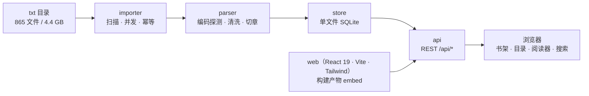
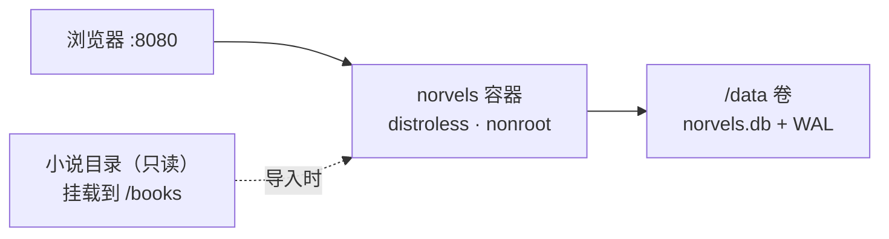

# norvels

**把一大堆中文 txt / EPUB 小说变成一个可浏览、可搜索的私人书库**：单二进制 + 单 SQLite 文件 + 轻量容器镜像，无外部依赖、不联网。

> 4.4 GB / 865 个文件的中文 txt，一次导入后得到「书架 → 目录 → 阅读 → 找书」的完整使用体验。

## 功能特性

- **多格式导入**：`.txt` / `.epub` / `.zip`（浏览器上传或目录扫描）。EPUB 自动带出书名/作者/简介/分类/系列、封面与目录层级（卷）；zip 包内逐条导入，条目名带 `包名.zip:包内路径`。不支持的格式与包内条目当场提示原因，不静默跳过。
- **编码自适应**：UTF-8 / UTF-8 BOM / GB18030 / UTF-16 / Big5 多候选解码 + CJK 命中率打分，乱码文件也能正常入库。
- **智能切章**：识别「第X章/节/回/卷/部」「数字行」「Chapter N」「序章/楔子/番外」，支持卷/部嵌套、无标记短篇兜底；单文件多书合集按章号重置自动拆成多本。
- **幂等导入**：按文件 SHA-256 去重，重复导入自动跳过；支持 `--force`、`--update`（追更只追加新章）、`--dry-run`、`--workers`、`--min-chapters`。
- **书名/作者/章节标题检索**：SQLite 索引上的 `LIKE`，毫秒级返回（不含正文全文索引，见 [ADR-0002](docs/adr/0002-drop-fulltext-index.md)）。
- **封面与元数据可编辑**：有封面的书在书架与详情页显示真实封面；书名/作者/简介/标签/系列可在详情页直接改。
- **零运行时依赖**：前端构建产物 `go:embed` 进二进制，容器里只有两个静态可执行文件。
- **轻量镜像**：distroless/static + 非 root，约 15.5 MiB（实测二进制 11.1 MiB + 健康检查 2.1 MiB + 基镜像约 2 MiB；前端合入后 16–18 MiB，详见 [docs/deploy.md](docs/deploy.md)）。
- **数据即文件**：所有内容存在 `/data/norvels.db`（SQLite + WAL），备份/迁移就是复制一个文件（用备份脚本正确处理 WAL）。

## 架构



部署形态（Docker）：



## 目录结构

```text
norvels/
├── cmd/
│   ├── norvels/            # 主程序：import / serve / stats / check-content / migrate / version
│   └── healthcheck/        # 镜像内健康检查（distroless 无 curl，用它请求 /api/health）
├── internal/
│   ├── api/                # REST 路由、中间件、SPA 静态资源
│   ├── ebook/              # EPUB 解包（zip → OPF → spine → 纯文本/元数据/封面）
│   ├── importer/           # 目录扫描、并发解析、幂等入库、上传落盘、进度
│   ├── model/              # 领域类型（ParsedBook / Chapter ...）
│   ├── parser/             # 编码探测、文本清洗、章节切分
│   ├── store/              # SQLite 打开/迁移/查询
│   └── webui/              # go:embed 前端产物
├── web/                    # React 19 + TypeScript + Vite + Tailwind
├── deploy/
│   ├── Dockerfile          # 三阶段：node → golang → distroless
│   └── compose.yml         # 服务编排（端口/卷/健康检查/重启策略）
├── scripts/
│   ├── import.sh           # 批量导入（本地 / docker 两种模式）
│   └── backup.sh           # SQLite 备份 + 保留策略
├── docs/
│   ├── architecture.md     # 组件划分与数据模型
│   ├── api.md              # REST API 契约
│   └── deploy.md           # 构建、体积、SQLite on volume、资源建议
├── data/                   # 运行时生成（已 gitignore）
├── Makefile
├── go.mod
└── README.md
```

## 快速开始

### 本地（3 条命令）

```bash
make build                                                   # 构建前端 + 后端（产物 bin/norvels）
./bin/norvels import --dir "/path/to/txt" --db ./data/norvels.db          # 整个目录
./bin/norvels import --dir "/path/to/某本书.txt" --db ./data/norvels.db   # 或单个 txt
./bin/norvels serve --addr :8080 --db ./data/norvels.db
```

`--dir` 同时接受目录和单个 `.txt` / `.epub` / `.zip` 文件：给目录就批量扫描（`--recursive` 控制是否进子目录），
给文件就只导这一本。传入其他扩展名的文件会直接报错，不会静默导 0 本。

打开 <http://127.0.0.1:8080> 即可使用；接口在 <http://127.0.0.1:8080/api/stats>。
只改后端时用 `make build-server`（复用已有 `internal/webui/dist`，跳过前端构建）。

### Docker（3 条命令）

```bash
docker build -f deploy/Dockerfile -t norvels:0.2.4 .          # 1) 构建镜像
NORVELS_BOOKS_DIR="/path/to/txt" docker compose -f deploy/compose.yml \
  run --rm --entrypoint /norvels norvels import --dir /books --db /data/norvels.db   # 2) 先导入
NORVELS_BOOKS_DIR="/path/to/txt" docker compose -f deploy/compose.yml up -d         # 3) 启动
```

- 端口：宿主 `8080` → 容器 `8080`；
- 数据：宿主 `./data/norvels.db` → 容器 `/data/norvels.db`；
- 源目录：`/path/to/txt` 挂载到容器 `/books`（**只读**，不会被修改）。

## 导入 4.4 GB / 865 个文件

以下命令使用本机真实数据目录（路径含中文与空格，**所有路径都要加引号**）。源目录只读，脚本不会修改其中任何文件。

### 本地二进制

```bash
# 1) 构建（Makefile 用 -trimpath -ldflags "-s -w" 并注入版本）
make build-server

# 2) 导入（workers 默认 min(NumCPU, 8)；--min-chapters 0 表示全收）
time ./bin/norvels import \
  --dir "/path/to/txt" \
  --db ./data/norvels.db \
  --workers 4

# 3) 校验
./bin/norvels stats --db ./data/norvels.db
```

### Docker（脚本一键）

```bash
# 源目录只读挂载到 /books，数据库写入宿主 ./data（容器内 /data/norvels.db）
docker build -f deploy/Dockerfile -t norvels:0.1.0 .
scripts/import.sh --mode docker \
  --dir "/path/to/txt" \
  --db ./data/norvels.db --workers 4
```

等价的原始 `docker run`：

```bash
docker run --rm --entrypoint /norvels \
  -v "/path/to/txt:/books:ro" \
  -v "$PWD/data:/data" \
  norvels:0.2.4 \
  import --dir /books --db /data/norvels.db --workers 4
```

### 参考耗时与空间

| 指标 | 参考值 | 说明 |
|---|---|---|
| 文本总量 | 4.1–4.4 GB | `du -sh` 实测 4.1 GB；`find -iname '*.txt'` 计数 865 个 |
| 导入耗时（单机 SSD，并发 4） | 约 10 分钟 | 838 个文件 / 4.1 GB 实测 10 分 25 秒；解析 CPU 密集，1C1G 约翻倍 |
| 导入耗时（单文件） | 数十毫秒–数秒 | 取决于文件大小（单文件最大约 42 MB） |
| 主库体积 | **1.62 GB** | 838 本 / 42.3 万章 / 4.87 GB 正文；正文按 1 MB 块 zstd 压缩，压缩率 34.7%（[ADR-0003](docs/adr/0003-block-compressed-content.md)） |
| 磁盘预留 | ≥ 5 GB | 主库 1.62 GB + 一份备份；**从旧库升级当次峰值 ≥ 35 GB**（迁移期间新旧数据并存） |

导入后可重复执行：内容未变的文件按 SHA-256 命中直接跳过；需要重解析时加 `--force`。

## 常用命令

| 命令 | 作用 |
|---|---|
| `make build` | 构建前端并同步到 `internal/webui/dist`，再编译 `bin/norvels` |
| `make build-server` | 只编译后端（要求 `internal/webui/dist` 已有前端产物） |
| `make run` | 本地启动服务（`:8080`，`./data/norvels.db`） |
| `make test` | 运行全部 Go 测试 |
| `make fmt` | gofmt |
| `make docker` | 构建容器镜像 |
| `scripts/import.sh --dir <目录>` | 批量导入（本地二进制模式） |
| `scripts/backup.sh --keep 7` | 备份数据库并保留最近 7 份 |
| `make bench-capacity` | 容量压测（500 本 x 500 章合成库，不碰生产库） |
| `./bin/norvels version` | 版本、commit、构建时间 |

## API 一览

完整契约见 [docs/api.md](docs/api.md)。Base 为 `/api`，响应均为 JSON。

| 方法 | 路径 | 说明 |
|---|---|---|
| GET | `/api/health` | 健康检查（`status`、`db`、`version`、`uptimeSeconds`） |
| GET | `/api/stats` | 库级统计（书籍/章节/作者/字数/库大小） |
| GET | `/api/version` | 版本信息 |
| GET | `/api/books` | 书籍列表（`q`、`authorId`、`tag`、`sort`、分页） |
| GET | `/api/books/{id}` | 书籍详情 + 卷/章目录 |
| GET | `/api/books/{id}/chapters` | 轻量章节列表（目录虚拟滚动） |
| GET | `/api/books/{id}/chapters/{cid}` | 章节正文（含 prevId/nextId） |
| GET | `/api/books/{id}/cover` | 封面图片（无封面 404） |
| PATCH | `/api/books/{id}` | 改书名/多作者/简介/标签/系列（支持清空） |
| POST | `/api/import/upload` | 浏览器上传 txt/epub/zip（multipart，逐文件 accepted/rejected） |
| GET | `/api/authors` | 作者列表（`q`、分页） |
| GET | `/api/authors/{id}` | 作者详情 + 作品 |
| GET | `/api/search` | 书名 / 作者 / 章节标题检索（`q`、`type=chapter|book|all`） |
| GET | `/api/tags` | 标签列表 |
| POST | `/api/import` | 触发导入（202 + jobId；并发导入返回 409） |
| GET | `/api/import/jobs` | 导入任务列表 |
| GET | `/api/import/jobs/{id}` | 任务详情 + 失败明细 |

## 容器资源建议

| 场景 | CPU | 内存 | 磁盘 | 依据 |
|---|---|---|---|---|
| 日常浏览 | 1 vCPU | 1 GB | 数据卷大小 | Go 服务 RSS 约 50–100 MB；SQLite 页缓存上限约 64 MB（`cache_size=-65536`） |
| 导入 4.4 GB | 2 vCPU | 2 GB | ≥ 5 GB 空闲 | 解析 CPU 密集（并发上限 8）、SQLite 写入 IO 密集、库最终约 1.6 GB、WAL 峰值数十 MB |
| 容量压测 | 1 vCPU | 1 GB | 临时目录 ≥ 2 GB | `make bench-capacity` 默认小规模，库建在系统临时目录、跑完自动删 |

- 磁盘用本地 SSD；网络盘（NFS/SMB）上的 SQLite 锁语义不可靠。
- 导入期间不要同时备份（见下）；导入结束会 `wal_checkpoint(TRUNCATE)` 收敛体积。
- 详细说明与估算来源：[docs/deploy.md](docs/deploy.md#6-资源建议)。

## 常见问题

### 中文乱码怎么办？

服务端按 UTF-8 输出 JSON，终端 locale 不影响数据。入库时 parser 会做多候选解码：

1. `./bin/norvels import --dry-run --dir "<目录>"` 先试跑，观察解析告警；
2. `GET /api/books/{id}` 的 `encoding` 字段会显示探测结果（`utf-8`、`gb18030`、`big5`、`utf-16le` 等）；
3. 若个别文件仍乱码，多为「GBK 主文 + 少量 UTF-8 广告行」或文件损坏，可先用系统工具确认原始编码，再反馈样本。

### 章节没有切开？

章节切分是启发式规则，已覆盖：`第X章/节/回/卷/部`、`Chapter N`、纯数字行、`序章/楔子/番外/尾声`，以及无标记短篇的整篇兜底。排查顺序：

1. 用 `--dry-run` 看该文件的 `Warnings`；
2. 确认标题行是否被广告清洗规则误删（parser 会去掉含网址/水印的行）；
3. 若文件是「多书合集」：章号重置点会被自动识别并拆成多本（每段至少 3 章，书名取段内书名标记）；拆不开时按单本导入并在 `Warnings` 里说明。

### 镜像为什么这么小？

三阶段构建 + `CGO_ENABLED=0`（纯 Go SQLite）+ `-trimpath -ldflags "-s -w"` + distroless/static（无 shell、apt、curl）。
体积拆解见 [docs/deploy.md](docs/deploy.md#3-镜像体积拆解)：二进制 **11.1 MiB**（linux/amd64 实测，含 x/text）、healthcheck **2.1 MiB**、distroless 基镜像约 2 MB，合计约 **15.5 MiB**；前端产物 embed 进二进制，合入后约 16–18 MiB。

### 备份时要连 WAL 一起备吗？

**不要直接 `cp norvels.db`**：WAL 模式下未 checkpoint 的数据在 `norvels.db-wal` 里，单拷主库会丢数据。正确做法：

```bash
scripts/backup.sh --keep 7          # 内部用 sqlite3 .backup 或 VACUUM INTO，自动包含 WAL
```

- `.backup` 是 SQLite 在线备份 API，服务运行中也能拿到一致快照；
- `VACUUM INTO` 会拿写锁，导入期间避免执行；
- **容器场景：导入期间不要并发备份**（compose 先 `docker compose stop`，导入完成、`wal_checkpoint(TRUNCATE)` 结束后再备份）；
- 恢复：停服务 → 用备份文件替换 `data/norvels.db` → 删除遗留的 `-wal`/`-shm` → 启动。

## 设计取舍与调研结论

几条经过实测的取舍：

- **最接近的参考实现是 zreader**：Go 单二进制 + `modernc.org/sqlite` + React SPA `go:embed`，作者自述约 23 MB 镜像，证明「Go + SQLite + 中文 txt」能在 20 MB 量级落地。
- **正文检索已主动放弃**：早期用「字级分词镜像列 + FTS5」支持 2 字及以上正文检索，但实测它占掉全库 65% 的体积（838 本 14.84 GB 里 9.58 GB 是索引）。用户不需要按正文内容检索，因此移除正文索引，检索收敛为书名 / 作者 / 章节标题的 `LIKE`（5 万本实测 18.4 ms）。决策与后果见 [ADR-0002](docs/adr/0002-drop-fulltext-index.md)。
- **体积不是瓶颈，磁盘与导入耗时才是**：镜像约 15.5–18 MiB，远低于 50 MB；4.4 GB 语料的 `/data` 需要 ≥ 20 GB。
- 调研与本文都确认：本机没有容器运行时，镜像体积需在装好 Docker 的机器上用 `docker images` 对账（见 [docs/deploy.md](docs/deploy.md#23-已知限制重要)）。

## 隐私与仓库卫生

本仓库只包含**工具本身**，不含任何书库内容：原始 txt 与数据库文件都不入库，文档与原型示例也已脱敏
（本机路径统一写成 `/path/to/txt`，书名/作者用虚构名）。提交前跑一次扫描：

```bash
make privacy      # scripts/privacy-scan.sh --all：本机路径 / 内网 IP / 令牌 / 本地黑名单书名
make verify       # 完整门禁：gofmt + go vet + go test + 隐私扫描
```

细则（哪些进仓库、脱敏规则、历史清理）见 [docs/privacy.md](docs/privacy.md)。

## 文档

- [架构与数据模型](docs/architecture.md)
- [语料画像与容量推算](docs/data-profile.md)
- [ADR-002：移除正文全文索引](docs/adr/0002-drop-fulltext-index.md)
- [REST API 契约](docs/api.md)
- [部署指南（构建参数、体积、SQLite on volume、资源建议、升级回滚）](docs/deploy.md)
- [隐私与仓库卫生](docs/privacy.md)

## 许可证

MIT
